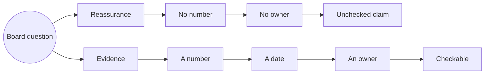

The board asks, "Are we secure against AI attacks?" The CISO says, "Yes, we have it covered."

That exchange feels like oversight. It is not. The question can only be answered with a feeling, so the answer is one too.

The useful question is narrower: **if an AI agent in our company, or one attacking it, did something wrong in the next ten minutes, who would know, who could stop it, and how long would that take?** Everything below is a way of getting an answer to that with numbers attached.

This follows [[Cybersecurity Was Built for Human Speed]], which argued that attackers move in minutes while approvals take hours. Here is the practical version, for the people who have to ask.

## The short version

Boards should ask five things about AI agent security:

1. How many agents and AI tools actually run here, and who owns each?
2. What can each one reach, and what is it allowed to do?
3. What happens automatically in the first ten minutes of an incident?
4. Can we stop one agent without stopping the business, and how fast?
5. When did we last practise this, and what broke?

A good answer has a number, a date and a named owner. A weak answer has reassurance.



## Why the usual board questions fall short

Most published advice for directors lands in the same place: ask what AI the company uses, who owns the risk, and how it is governed. That is fair, and Grant Thornton adds a sharper version, asking who owns the risk classification of each AI use case, what triggers a re-review, and whether controls tightened when an agent gained new data access or decision authority after launch.[^1]

The gap is time. Governance questions ask whether a process exists. Agents act while the process is still being convened. So the questions below keep the governance angle, but force a measurement.

## 1. How many agents run here, and who owns each?

Ask for the number and the name. Do not accept the number of tools that were approved. Ask for the number found running.

This matters because the unapproved ones are the ones nobody is watching. Cloud Security Alliance research names the missing AI asset inventory as the basic failure behind shadow AI.[^2] Crowe points out that even a good inventory goes stale, because AI keeps arriving inside vendor platforms the company already bought.[^3]

- **Strong:** a recent inventory built from what is actually on devices and networks, with an owner per entry and a date.
- **Weak:** a survey, a policy, or a list of approved tools.

## 2. What can each agent reach and do?

An agent's risk is not its model. It is its access. An agent that can read email, open files and call internal tools has the reach of a person, and none of a person's hesitation.

Check Point frames the test well: should *this* agent perform *this* action, in *this* context, *right now*?[^4] That is a better board question than "do we have access controls", because it fails loudly when the answer is "we don't check at that level".

- **Strong:** for the ten most powerful agents, a one-line statement of what each can reach and why it needs to.
- **Weak:** "it uses the employee's login", which means it can reach everything that employee can.

## 3. What happens automatically in the first ten minutes?

If every response step waits for a person, the first ten minutes belong to the attacker. The fix is to decide in advance: which actions need no sign-off, for example locking an account, ending a session or isolating a machine, and within what limits.

Crowe makes a related point about agents themselves: when decisions chain together without a human checkpoint, you need defined triggers that escalate to a person.[^3] The same logic applies to your response. Pre-approve the small, reversible actions. Keep people for the big ones.

- **Strong:** a short written list of pre-approved actions, each with limits and an approver.
- **Weak:** "the analyst escalates", with no list.

```mermaid The first ten minutes: pre-approved actions fire at once, and only the risky calls wait for a person.
flowchart LR
  %% animate
  accTitle: First ten minutes of a response
  accDescr: An alert arrives. Small, pre-approved actions such as locking an account or isolating a machine run immediately. Risky decisions are routed to a person with context. Everything is written to a replayable record.
  A((Alert)) --> P{Pre-approved?}
  P -->|Yes| F[Act now: lock, end session, isolate]
  P -->|No| H[Route to a person with context]:::alert
  F --> L[Replayable record]
  H --> L
```

## 4. Can we stop one agent without stopping the business?

A kill switch sounds like the answer. It is part of it. Okta's guidance argues that each agent needs its own identity, not a shared or borrowed one, so you can cut it off without locking out a human.[^5] The Hacker News adds that a kill switch should be treated as a tested set of controls: stop queued runs, revoke credentials, restrict network paths.[^6]

It is also not enough alone. A Futurum Group report argues that a kill switch acts after the fact, stops the whole agent rather than one bad action, and only fires if someone notices in time. It reports that 56.9% of security decision-makers say they cannot detect or contain a compromised agent at machine speed.[^7] That is a vendor-commissioned survey and I have only seen its summary, so read it as a signal, not a benchmark.

- **Strong:** a named role, a tested procedure, and a measured time to cut off one agent.
- **Weak:** "we would disable the user", when the agent holds its own credentials and keeps working.

## 5. When did we last practise this, and what broke?

A drill that found nothing was probably too easy. The best answer opens with the awkward finding.

- **Strong:** a recent exercise, one thing that failed, and what changed afterwards.
- **Weak:** "no issues found", or no exercise.

## A scorecard to reuse each quarter

Ask the same five every quarter and write the answers down. The trend matters more than any single answer.

1. **Inventory.** Ask for the count found running and an owner for each entry. A good answer: "47 found, 41 owned, 6 under review, as of this week."
2. **Reach.** Ask for the access of the ten most powerful agents. A good answer: "Each has a written scope, reviewed this quarter."
3. **First ten minutes.** Ask for the list of pre-approved actions. A good answer: "Four actions fire without sign-off, each with limits."
4. **Stop one agent.** Ask for the time to cut off a single agent. A good answer: "Measured at 6 minutes in the last drill."
5. **Practice.** Ask for the last exercise and what failed. A good answer: "Last month. The revoke step missed one credential. Fixed."

Take it into the meeting. The printable version below has room to write each answer, rate it and name an owner. Fill it in on screen or print it.

[Board scorecard](/printables/board-scorecard)

The example answers above are illustrations of the shape of a good answer, not benchmarks. Nobody has published a standard time-to-contain for AI agents yet, so the first goal is simply to have your own number.

## How to say it in business terms

Directors do not need the technology. They need the outcome. One practical framing from the advisory literature is to translate every AI risk into a short set of enterprise outcomes: operations halted, data exposed, a regulator to notify, customers harmed, money lost, reputation damaged.[^8] If an answer cannot be tied to one of those, it probably does not belong in the boardroom.

## Frequently asked questions

**What is the biggest AI security risk for a board to watch?**
Unknown agents with real access. You cannot govern or stop what nobody has counted.

**Should a board ask about AI agents separately from general AI governance?**
Yes. General governance asks whether policy exists. Agents act on their own, with credentials, at machine speed, so the board needs a measured response time, not just a policy.

**Is a kill switch enough to contain an AI agent?**
It helps, but it is not a strategy on its own. It works best when each agent has its own identity, the procedure is tested, and detection is fast enough for someone to press it.

**How often should a board ask these questions?**
Quarterly, with the same five questions each time so the trend is visible.

## Where to start

Pick the one question your team would struggle with most, and ask it this week. If it is the first, you are in good company: most organisations do not know their number yet.

A note from me: this is the problem we work on at [SuperAlign](https://superalign.ai), where I am co-founder, mainly finding the AI agents, MCP servers and extensions running on company devices and what each can reach. If question 1 is the hard one for you, I am happy to talk: contact@superalign.ai.

---

## References

[^1]: Grant Thornton, "AI risk is rising: is your board keeping pace?", 2026. https://www.grantthornton.com/insights/articles/audit/2026/ai-risk-is-rising-is-your-board-keeping-pace (risk classification ownership, review triggers, controls after new access). Advisory firm source; read from a search summary.
[^2]: Cloud Security Alliance, "The Invisible Enterprise: Shadow AI and the Ungoverned Frontier". https://labs.cloudsecurityalliance.org/research/csa-whitepaper-shadow-ai-asset-blindness-systemic-risk-20260/ (absence of a comprehensive AI asset inventory). Read from a search summary.
[^3]: Crowe, "3 Ways AI Governance Is Getting Harder for Boards". https://www.crowe.com/insights/3-ways-ai-governance-is-getting-harder-for-boards (stale inventories, AI embedded in vendor platforms, escalation triggers for autonomous agents). Advisory firm source; read from a search summary.
[^4]: Check Point, "Can we control every AI agent before it becomes our next privileged insider?". https://blog.checkpoint.com/ai-security/can-we-control-every-ai-agent-before-it-becomes-our-next-privileged-insider/ (the per-action authorisation question). Vendor source; read from a search summary.
[^5]: Okta, "What is an AI kill switch?". https://www.okta.com/blog/ai/ai-agent-kill-switch-guide/ (per-agent identity so revocation does not affect human accounts). Vendor source.
[^6]: The Hacker News, "When an AI agent goes wrong, can you stop it?", November 2026. https://thehackernews.com/2026/11/when-ai-agent-goes-wrong-can-you-stop-it.html (kill switch as a tested set of controls). Read from a search summary.
[^7]: Futurum Group, "Agent Security: The Kill Switch Is Not a Containment Strategy", November 2026. https://futurumgroup.com/wp-content/uploads/2026/11/Agent-Security_-The-Kill-Switch-Is-Not-a-Containment-Strategy_AIOFM202610.pdf (56.9% figure and the after-the-fact critique). Vendor-linked survey; read from a search summary, not the full report.
[^8]: Cyberhaven, "How to present AI risks to the board". https://www.cyberhaven.com/blog/present-ai-risks-to-board (translating AI risk into enterprise outcomes). Vendor source; read from a search summary.
